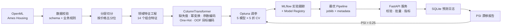
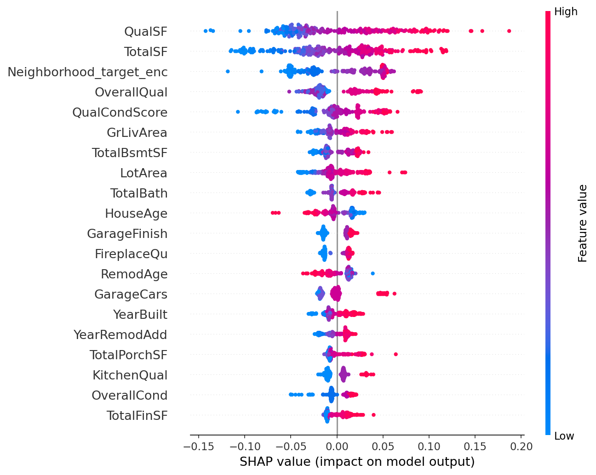
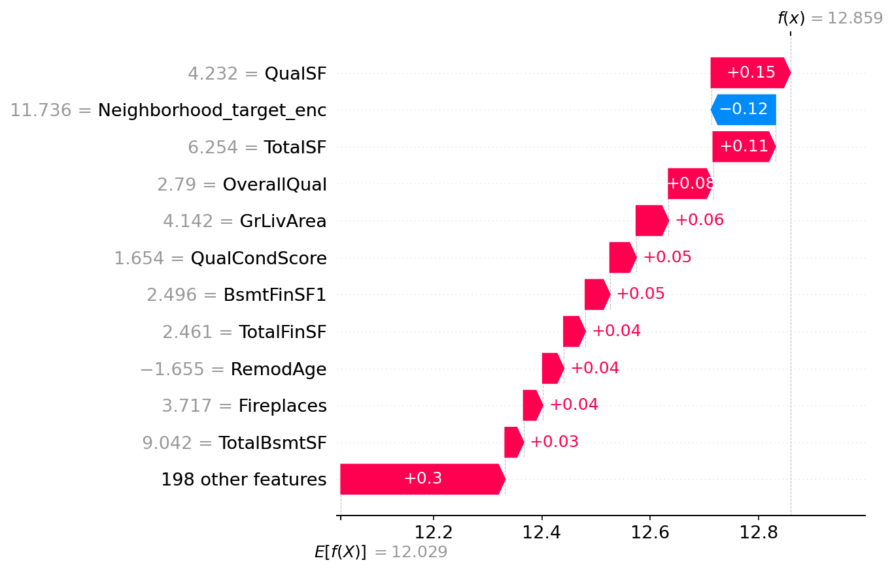
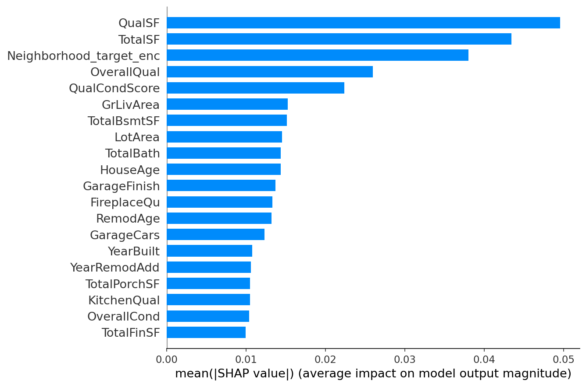
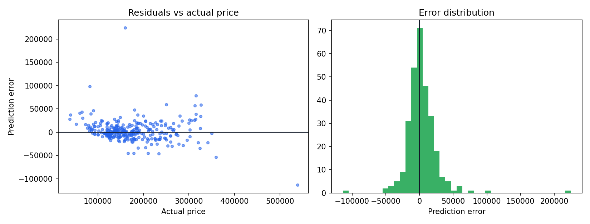

# 房价预测 MLOps 流水线

> 从数据校验、特征工程、超参搜索到在线服务与漂移监控的完整机器学习工程实践。
>
> End-to-end house price regression with reproducible feature engineering, Optuna tuning,
> SHAP explainability, FastAPI serving and PSI-based drift monitoring.


---

## 核心结果

在 Ames Housing 数据集的留出测试集（292 条）上：

| 指标 | 数值 |
|---|---:|
| MAE | **$14,452** |
| RMSE | **$23,800** |
| R² | **0.8735** |
| MAPE | **9.32%** |
| 中位绝对误差 | $9,934 |

- 模型选择基于 **5 折交叉验证的对数空间 RMSE**，测试集只用于最终报告，不参与选型
- 5 个模型 × 20 次 Optuna 试验，实验参数、指标与模型全部记录到 MLflow
- 特征工程消融实验：交叉验证 RMSE 相对基线降低 **2.79%**，测试集 R² 从 0.8881 提升到 **0.9003**

---

## 项目架构



所有预处理与模型被封装成**单个 sklearn Pipeline** 落盘。训练和推理共用同一套变换逻辑，从结构上杜绝训练/推理不一致与数据泄漏。

---

## 模型对比（5 折交叉验证 + 留出集）

调参目标为对数空间 RMSE（越小越好）；测试集指标在美元口径下计算。

| 模型 | CV RMSE(log) | 测试 MAE | 测试 RMSE | 测试 R² | 测试 MAPE | 调参耗时 |
|---|---:|---:|---:|---:|---:|---:|
| **CatBoost**（部署） | **0.1177** | $14,452 | $23,800 | 0.8735 | 9.32% | 900s |
| Ridge | 0.1196 | $15,768 | $56,735 | 0.2810 | 10.34% | 40s |
| LightGBM | 0.1210 | $13,437 | $22,069 | **0.8912** | **9.08%** | 207s |
| XGBoost | 0.1303 | $15,039 | $25,520 | 0.8545 | 10.14% | 83s |
| Random Forest | 0.1309 | $15,069 | $23,855 | 0.8729 | 10.30% | 434s |

两点值得说明：

1. **CatBoost 与 LightGBM 的差距在交叉验证噪声范围内**（CV 标准差约 0.0025–0.0041），但 CatBoost 在 CV 上胜出，因此按预先定义的选型规则部署 CatBoost，而不是用测试集结果反向挑选模型。
2. **Ridge 的测试 R² 只有 0.28**，不是代码错误：Ames 数据中存在两套"部分产权出售"的极端样本（例如 5642 平方英尺却只卖 16 万美元），线性模型会沿面积外推导致预测严重偏高。树模型天然有界，不受影响。这个现象在 `reports/worst_predictions.csv` 中有逐条记录。

---

## 特征工程消融实验

固定 LightGBM 参数，只改变特征处理方式，评估每一步的真实贡献（`reports/ablation.csv`）：

| 方案 | CV RMSE(log) | 测试 MAE | 测试 R² | 特征数 | 相对基线提升 |
|---|---:|---:|---:|---:|---:|
| 原始特征 + One-Hot | 0.12786 | $14,046 | 0.8881 | 247 | — |
| + 领域组合特征 | 0.12599 | $13,797 | 0.8926 | 262 | +1.46% |
| + 目标编码 | **0.12429** | $14,366 | **0.9003** | 209 | **+2.79%** |

构造的 14 个领域特征包括：总建筑面积 `TotalSF`、卫浴总数 `TotalBath`（半卫计 0.5）、门廊总面积、房龄/翻新龄/车库龄、单位房间面积、质量×面积交互 `QualSF`、地下室占比、车库占比等。

编码策略：

- **有序变量**（Ex/Gd/TA/Fa/Po 等 18 列）按语义映射为 1–5，缺失表示"无该设施"映射为 0
- **低基数类别**（23 列）One-Hot，未知类别安全忽略
- **高基数类别**（Neighborhood、Exterior1st/2nd）采用**平滑的折外目标编码**：训练时用 K 折保证每行编码值不包含自身标签，推理时使用全量平滑统计，未知类别回退到全局先验
- **连续偏态特征**（面积、地价等）经 Yeo-Johnson 幂变换并标准化
- 缺失值：数值用训练集中位数，并额外生成缺失指示变量

---

## 可解释性（SHAP）



| 排名 | 特征 | 平均 \|SHAP\| |
|---:|---|---:|
| 1 | `QualSF`（质量×居住面积） | 0.0496 |
| 2 | `TotalSF`（总建筑面积） | 0.0434 |
| 3 | `Neighborhood` 目标编码 | 0.0380 |
| 4 | `OverallQual` | 0.0260 |
| 5 | `QualCondScore`（质量×状况） | 0.0224 |

- 组合特征 `QualSF`、`TotalSF` 的重要性超过任何原始单列，与消融实验中领域特征带来的增益相互印证
- 置换重要性（`reports/permutation_importance.csv`）给出相同排序，说明结论不依赖单一解释方法

单样本瀑布图（误差最大的样本，模型给出的对数价格分解）：



其余诊断图（全局重要性、残差分布）：




误差分析按价位段和社区拆分：

| 价位段 | 样本数 | MAE | MAPE | 平均偏差 |
|---|---:|---:|---:|---:|
| Q1（$37.9k–128.5k） | 75 | $12,268 | 14.8% | −$7,247 |
| Q2（$129.5k–161.5k） | 71 | $11,627 | 7.8% | −$4,323 |
| Q3（$162.0k–212.9k） | 73 | $13,394 | 7.2% | +$1,362 |
| Q4（$215.0k–538.0k） | 73 | $20,500 | 7.3% | −$911 |

低价房存在系统性的**低估**（Q1 平均低 $7.2k），高价房误差更大但偏差较小。这是后续改进最明确的方向。

---

## 在线服务

```bash
hpp serve --port 8000
# Swagger: http://127.0.0.1:8000/docs
```

| 方法 | 路径 | 说明 |
|---|---|---|
| GET | `/health` | 真实检查模型加载状态与版本 |
| GET | `/model/info` | 模型类型、训练行数、CV/测试指标、依赖版本 |
| GET | `/features` | 必填/可选字段与合法类别 |
| POST | `/predict` | 单条预测 |
| POST | `/predict/batch` | 批量预测（上限 1000） |
| GET | `/metrics` | Prometheus 指标（请求数、延迟、预测分布） |

```bash
curl -X POST http://127.0.0.1:8000/predict \
  -H "Content-Type: application/json" \
  -d '{
    "OverallQual": 7, "GrLivArea": 1710, "TotalBsmtSF": 856,
    "1stFlrSF": 856, "2ndFlrSF": 854, "GarageCars": 2,
    "GarageArea": 548, "YearBuilt": 2003, "YearRemodAdd": 2003,
    "FullBath": 2, "TotRmsAbvGrd": 8, "Fireplaces": 1,
    "LotArea": 8450, "Neighborhood": "CollgCr", "MSZoning": "RL"
  }'
```

工程细节：

- 模型在 **lifespan 启动时加载一次**，请求路径不再重复 `joblib.load`
- 15 个核心字段必填，其余 64 个字段可选；缺失值由 Pipeline 内的训练统计量填充，因此接口对调用方友好
- Pydantic v2 做类型、范围与枚举校验；未知字段、越界值、未知社区分别返回 422/422/400，错误结构统一
- 每次请求生成 `x-request-id`，结构化 JSON 日志记录延迟与状态码
- 预测值按训练集 0.5%/99.5% 分位数截断，避免极端外推

---

## 漂移监控

- 训练时保存每个特征的分布快照（数值分位数+分箱占比、类别频率、缺失率）
- 服务端把请求写入 SQLite 预测日志，`hpp drift` 计算 **PSI** 与 KS 统计量
- 阈值：PSI < 0.1 稳定；0.1–0.25 关注；> 0.25 触发重训
- 为避免小样本误报：少于 200 条请求直接标记 `insufficient_data`；类别频率低于 2% 的稀有类别合并后计算；只比较调用方**实际提供**的字段，避免"可选字段未填"被误判为数据漂移

用同分布的 292 条测试样本回放，最大 PSI 为 0.119（Neighborhood），未触发重训；
人为把居住面积放大 2.5 倍、房龄加 30 年、社区替换为未知值后，同一套检测逻辑正确识别出
`GrLivArea`、`YearBuilt`、`Neighborhood` 三个漂移特征（`reports/drift_demo.html`）。

HTML 报告示例：`reports/drift_report.html`（真实回放）、`reports/drift_demo.html`（人为漂移）。

---

## 快速开始

### 环境要求

- Python **3.10+**（开发与验证使用 3.10.10）
- 约 2 GB 磁盘（依赖；Docker 镜像另需约 2.5 GB）
- 首次执行 `hpp prepare` 需要联网访问 OpenML（约 2 MB）

### 1. 安装

```bash
python -m venv .venv
# Windows
.venv\Scripts\activate
# macOS / Linux
source .venv/bin/activate

pip install -e ".[train,dev]"   # 只运行服务可改为 pip install -e .
```

### 2. 直接运行（仓库已附带训练好的模型，无需重新训练）

```bash
hpp serve          # http://127.0.0.1:8000/docs
```

克隆后即可加载 `models/house_price_pipeline.joblib` 提供预测；`hpp drift` 也能直接用
仓库里的参考分布计算漂移。

### 3. 完整复现

```bash
hpp prepare      # 下载 OpenML 数据 → 校验 → 分层切分        ~30 秒（联网）
hpp train        # Optuna 调参 + 5 模型对比 + MLflow + 落盘   约 25 分钟（单机 CPU）
hpp evaluate     # 测试指标、分组误差、SHAP、置换重要性       约 1 分钟
hpp ablation     # 特征工程消融实验                         约 1 分钟
hpp drift        # 基于预测日志计算数据漂移                  秒级
```

也可以一键执行 `hpp all`。只想快速验证训练链路可用
`hpp train --models lightgbm --trials 2`（约 30 秒）。

### 目录结构与模块职责

```text
house-price-mlops/
├── configs/                 # YAML 配置：数据路径、切分、调参、服务
├── src/house_price/         # 可安装的 Python 包（src layout）
│   ├── data/                # 摄取、schema、数据校验
│   ├── features/            # 自定义 Transformer、Pipeline、消融
│   ├── models/              # 模型工厂、调参、对比、注册、训练
│   ├── evaluation/          # 指标、误差分析、SHAP、EDA、报告
│   ├── monitoring/          # PSI/KS 漂移、SQLite 预测日志
│   ├── serving/             # Pydantic Schema、Predictor、FastAPI
│   ├── config.py            # 配置加载与路径解析
│   ├── logging_utils.py     # 结构化 JSON 日志
│   └── cli.py               # `hpp` 命令行入口
├── tests/                   # 单元 / 集成 / API 测试（60 个）
├── scripts/                 # 漂移定时任务、Space 部署脚本
├── reports/                 # 实验指标、图表、漂移报告（可复现）
├── models/                  # 最优 Pipeline + 元数据（随仓库提供）
├── data/reference/          # 训练分布快照（漂移检测基线）
├── Dockerfile / Makefile / pyproject.toml / constraints.txt
```

| 模块 | 职责 | 关键文件 |
|---|---|---|
| `data` | 下载/缓存数据、schema 定义、业务规则校验、分层切分 | `ingest.py` `validate.py` `schema.py` |
| `features` | 14 个领域特征、有序映射、折外目标编码、列变换组装 | `transformers.py` `pipeline.py` |
| `models` | 估计器工厂、Optuna 搜索、交叉验证、MLflow 注册 | `factory.py` `tune.py` `compare.py` |
| `evaluation` | 指标、分价位/分社区误差、SHAP、置换重要性、EDA | `metrics.py` `explain.py` `report.py` |
| `monitoring` | PSI/KS 漂移检测、参考分布、预测日志 | `drift.py` `prediction_log.py` |
| `serving` | 启动加载模型、请求校验、批量推理、指标与日志 | `api.py` `predictor.py` `schemas.py` |

### 仓库内容说明

| 随仓库提供 | 不提供（由命令生成或个人文件） |
|---|---|
| 全部源码、测试、配置、文档 | `.venv` 虚拟环境 |
| 训练好的 CatBoost Pipeline（0.9 MB）与元数据 | `data/raw`、`data/processed`（`hpp prepare` 生成） |
| 训练分布快照（漂移基线） | `mlruns/`、`mlflow.db`（`hpp train` 生成） |
| 实验结果、SHAP 图、漂移报告 | `data/predictions.db`（服务运行时生成） |
| Dockerfile、CI 配置 | 个人简历等私有文件 |

因此，**克隆后无需训练即可启动服务**；只有需要重新训练或复现实验时才执行 `hpp prepare && hpp train`。
所有随机种子、数据切分和超参数都在 `configs/` 与代码中固定，重复执行结果一致。

---

## 工程质量

| 项目 | 现状 |
|---|---|
| 测试 | 60 个测试，覆盖数据校验、特征变换、Pipeline、调参工具、指标、SHAP、API、漂移、预测日志 |
| 覆盖率 | 62%（`pytest --cov`） |
| 静态检查 | Ruff + mypy（31 个源文件零错误） |
| CI | GitHub Actions：lint → typecheck → test；push 时额外跑训练冒烟测试 |
| 可复现性 | 固定随机种子、配置驱动、依赖版本写入模型元数据 |

CI 说明：测试全部使用合成数据，不依赖网络，单次运行约 1 分钟。

---

## 部署

### Docker

```bash
docker build -t house-price-api .
docker run -p 8000:7860 house-price-api

# 国内网络访问 Debian 源困难时，可切换 apt 镜像（不影响 HF Spaces，默认走官方源）
docker build --build-arg APT_MIRROR=mirrors.tuna.tsinghua.edu.cn -t house-price-api .
```

多阶段构建，非 root 用户运行，内置健康检查，端口通过 `PORT` 环境变量配置（默认 7860）。
依赖通过 `constraints.txt` 锁定为训练时的版本，避免重建镜像后因库版本漂移导致模型反序列化失败。
镜像已在本地完成构建与运行验证（健康检查通过、预测结果与训练环境一致、预测日志可写入）。

### 公网托管

Hugging Face 自 2026 年 7 月起要求新建 Docker / Gradio Space 使用 PRO 订阅，免费账号仅支持静态空间。
如需公网链接，可选：

- 魔搭 ModelScope 创空间（国内免费，需阿里云实名认证，支持 Docker 运行时）
- 阿里云函数计算 FC（国内免费额度，容器镜像部署）
- 自有服务器 / 云主机：`docker run -d -p 8000:7860 house-price-api`

仓库中的 `scripts/deploy_space.py` 仍可用于已订阅 PRO 的 Hugging Face 账号。

---

## 报告索引

| 文件 | 内容 |
|---|---|
| `reports/model_comparison.csv` | 5 模型交叉验证与留出集完整对比 |
| `reports/ablation.csv` | 特征工程消融实验 |
| `reports/metrics.json` | 部署模型最终测试指标 |
| `reports/error_by_price_band.csv` | 分价位段误差 |
| `reports/error_by_neighborhood.csv` | 分社区误差 |
| `reports/worst_predictions.csv` | 误差最大的 10 条样本 |
| `reports/shap_feature_importance.csv` | SHAP 全局重要性 |
| `reports/permutation_importance.csv` | 置换重要性 |
| `reports/data_quality.json` | 数据校验报告 |
| `reports/eda_summary.json` | EDA 摘要 |
| `reports/drift_report.json` / `.html` | 线上请求漂移报告 |
| `reports/drift_demo.html` | 注入漂移后的检测示例 |
| `models/model_metadata.json` | 模型版本、参数、指标、依赖版本 |

---

## 设计取舍

- **不引入 Kubernetes / Kafka / Spark**：当前数据规模与团队场景用不上，写了也无法在面试中讲透，属于负收益的复杂度
- **不做自动重训**：只实现"检测 + 告警 + 手动触发"的闭环，自动重训需要标签回流与审批流程，超出项目边界
- **选型只看交叉验证**：测试集指标仅用于报告。虽然 LightGBM 的留出集表现更好，但按规则部署 CV 胜出的 CatBoost，避免"用测试集挑模型"的方法论错误
- **Pipeline 落盘而非裸模型**：保证推理时的预处理与训练完全一致，这是复现性的关键

---

## 局限与改进方向

1. 数据是 2006–2010 年的 Ames 静态快照，无法验证真实线上收益
2. 漂移监控只覆盖输入特征，没有真实标签回流，因此无法检测概念漂移
3. 低价房存在系统性低估，可尝试分位数回归或两阶段模型（先分类后回归）
4. 目标编码目前用 K 折实现，数据量更大时可换成 `category_encoders` 的嵌套 CV 方案
5. 后续可补充：批量离线打分、A/B 实验框架、模型卡片（Model Card）

---

## 数据来源

[Ames Housing](https://www.openml.org/d/42165)（OpenML `house_prices` v1，1460 条样本、79 个特征），
原始数据由 Dean De Cock 整理，常用于回归与特征工程研究。
